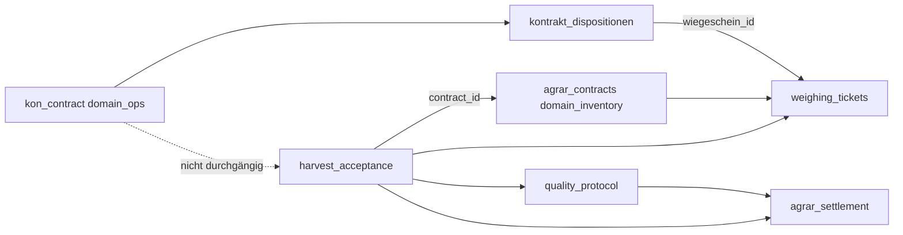

# Agrar E2E: Kontrakt → Disposition → Waage → Qualität → Abrechnung

## Zweck

Referenzbranche **Agrarhandel** (Landhandel Getreide/Rohware), **keine** harte Architekturgrenze: Dieselbe Kette ist das fachliche Leitbild aus `docs/architecture/target-state-landhandel-erp.md` und `app/core/e2e_chain.py` (Kontrakt → Annahme → Qualität → Settlement → FiBu).

Dieses Dokument legt den **IST-Stand im Repository** (Stand 2026-10-22, rein lesend erhoben) gegen fünf operativ getrennte Prozessschritte. Es behauptet **keine** End-to-End-Produktivreife und **keine** Vollständigkeit der Adaptive-Workspace-UI (Phase 1 = Launcher-Registry laut Slice-YAML).

## Methodik und Grenzen

- Quellen: FastAPI-Router-Mounts in `app/api/v1/api.py`, Domain-Services, native `ScreenDefinition`-Einträge in `app/core/screen_definitions*.py`, Process-Kernel-Events in `app/domains/shared/process_events.py`, Studio-Handbuch/QA.
- **Nicht** kartiert: MCP-Schreibpfade, NATS-Consumer-Produktivität, Touren-Godfiles, Dispo-UI-Implementierung, Workboard-Inhalt (nur Slice-Kontext gelesen).
- **PSM** (Pflanzenschutz): eigenes Compliance-/Stammdatenfeld (`agrar/psm-*`-Listen, `app/domains/agrar/api/psm.py`). Im Ernte-E2E-Schritt „Qualität“ ist **Rohware-/Labor-QS** gemeint (Feuchte, Besatz, HL-Gewicht), nicht PSM-Abgabeberatung.

## Bezug Adaptive Workspace

| Ebene (Zielbild Slice) | Agrar-E2E Nutzung (später) |
|-------------------------|----------------------------|
| **Kachel / View** | Cockpits `disposition/kontrakt-abruf`, Flow-Spine `harvest-to-settlement`, native Masken `agrar/kontrakte`, `waage/wiegeschein`, `agrar/harvest-settlement` |
| **Command (Strg+K)** | Deklarierte Business-Commands z. B. `ReleaseQualityProtocol`, `CreateAgrarSettlement`, `FinalizeHarvestAcceptance` (`app/core/business_commands.py`) — Registry-Anbindung Phase 1+ |
| **Inbox** | Kontroll-Worklists `annahme/qualitaets-check`, `agrar/ernte-qualitaetsfreigabe` (`app/core/screen_definitions_kontrolle*.py`) — Geschwister-Doc `adaptive-workspace-inbox.md` |
| **Dispo** | Kontrakt-Abrufe (`/api/v1/kontrakte/{id}/dispositionen`) vs. Logistik-Touren (`/api/v1/logistik/tours`) — Geschwister-Doc `adaptive-workspace-disposition.md` |

Master-Framework-Dokument `docs/architecture/adaptive-workspace-framework.md` war zum Kartierungszeitpunkt **nicht** im Workspace vorhanden (nur Slice-Referenz); Inhalt hier unabhängig davon.

---

## Prozessschritte — Ist, Events, Gaps, Workspace-Konsum

| # | Prozessschritt | Vorhandener Endpunkt / Service / Maske | Event (falls deklariert) | Gap (ehrlich) | Workspace später |
|---|----------------|----------------------------------------|---------------------------|---------------|------------------|
| **1** | **Kontrakt** | **API:** `GET/POST/PATCH …` `/api/v1/kontrakte` (`app/api/v1/endpoints/kontrakte.py`), Ergänzungen `/api/v1/kontrakte/{kontrakt_nr}/mengenzeitraeume` (`kontrakt_mengenzeitraum.py`), Engagement `/contracts/*` (`contract_settlement.py`, `contract_fixing.py`). **Daten:** `domain_ops.kon_contract` (+ lines, movements). **Service:** `app/services/kontrakte_service.py`, Restmengen, Amendments. **Maske:** native `agrar/kontrakte` → Route `/kontrakte` (`build_agrar_kontrakt_screen_definition`). **Prozess-UI:** `/workflow/flow-spine-contract-to-settlement`. | Kein dediziertes `kon_contract.created`-Kernel-Event in `process_events.py`; Audit über `KontraktAuditService`. | Zwei Kontrakt-Welten: UI/API **KonContract** (`domain_ops`) vs. Ernte-Annahme **`AgrarContract`** (`domain_inventory.agrar_contracts`, `weighing_tickets.py`, `harvest_acceptance_service.py`). Ein durchgängiger Mandanten-Kontrakt-Key über alle Schritte ist **nicht** eindeutig belegt. Amendments/Nachträge vorhanden, Lifecycle-Freigabe laut Target-State teils offen. | **Kachel:** Kontraktliste, Positionsmonitor `/api/v1/kontrakte/positionen`. **Command:** Kontrakt öffnen, Abruf anlegen (prepare → POST disposition). **Inbox:** CRM-360-Tab Kontrakte (`/api/v1/crm/customers/{id}/tabs/kontrakte`). |
| **2** | **Disposition** (kontrahierte Menge / Anlieferplanung) | **API Kontrakt-Abruf:** `GET/POST /api/v1/kontrakte/{kontrakt_id}/dispositionen`, `PATCH …/freigabe`, `PATCH …/geliefert` (bindet optional `wiegeschein_id` via `domain_inventory.weighing_tickets`) — `kontrakt_disposition_service.py`. **Parallel:** generisches `/api/v1/disposition/*` (`disposition.py`, Tabelle `ops_disposition`); **Logistik-Touren** `/api/v1/logistik/tours` (`logistics_tours.py`, `logistics_disposition_service.py`). **Masken:** Cockpit `disposition/kontrakt-abruf` (Read-Model, Datenquelle `/api/v1/kontrakte`); `strecke/disposition`; Seite `logistik/tourenplanung.tsx`. | Kein `disposition.*`-ProcessKernel-Event; Touren nutzen Command-Handler, Outbox teils logistiknah. | **Medienbruch:** Kontrakt-Abruf (Menge/Freigabe/Lieferung) ist **nicht** automatisch mit Tourenplanung oder `/disposition`-Positionen verknüpft. Cockpit `disposition/kontrakt-abruf` ist Übersicht, **kein** vollwertiger Abruf-Editor. Feld „Touren/Dispo“ im Referenzprozess = fachlich Abruf + optional Transport — Transportkette separat. | **Dispo-Kachel:** offene Abrufe `status=OFFEN|FREIGEGEBEN`, SLA aus Kontrakt-Fristen. **Command:** Abruf freigeben, als geliefert melden (mit Wiegeschein-Nr.). **Inbox:** fehlende Wiegeschein-Bindung bei `GELIEFERT`. |
| **3** | **Waage** | **API:** `/api/v1/waage/*` — Waagenstamm, Wiegungen, ASCII-Import, Kalibrierung (`waage.py`); **Wiegeschein-Register** `/api/v1/weighing-tickets/*` (`weighing_tickets.py`, Modell `WeighingTicket`, Allokation `AgrarContractAllocation`). **Mobile:** `waage_mobile` in `api.py`. **Masken:** `waage/wiegeschein` (Stamm), `waage/wiegungen-liste`, Studio-Wire `annahme/waage-2` (`MadeByStudioDetailRuntimeWire`). **Verknüpfung Annahme:** `harvest_acceptance.weighing_ticket_id`, Doppelwiegung/L3-Pfade in Tests/Doku (`open-gaps`: WAAGE-LIVE UAT offen). | Outbox/Integration über `supply_chain_event_service` (`stage=wiegung`, `ref_type=weighing_ticket`); kein einheitliches `tenant.agrar.weighing_ticket.completed` in `process_events.py` (nur Kommentar-Konvention). | Live-Hardware/Eich-UAT explizit offen (`open-gaps-and-known-issues.md`). **Zwei Eingangswege:** `/waage/wiegungen` vs. `/weighing-tickets` — Kette muss konsistent gewählt werden. Kontrakt-Abruf „geliefert“ erwartet **Register**-Schein, nicht freien Text. Studio-Waage (`annahme/waage-2`) ≠ produktive Waagenanbindung. | **Kachel:** Hofliste/Warteschlange (Handbuch `annahme.md`), Wiegeschein-Liste. **Command:** Wiegeschein öffnen, zur Annahme verknüpfen. **Inbox:** Import-Fehlerqueue `/waage/waagen/import/fehlerqueue`. |
| **4** | **Qualität** (Rohware/Labor) | **API:** `/api/v1/agrar/quality-protocols/*` (`quality_protocols.py`, Service `modules/agrar/services/quality_protocol_service.py`); nested an Annahme `POST/GET /api/v1/agrar/harvest-acceptance/{id}/qualitaetsprotokoll` (`harvest_acceptance.py`); QS-Charge-Link `quality_protocol_id` auf Annahme. **Aggregate:** `quality_protocol` in `aggregate_registry.py`, Command `ReleaseQualityProtocol` → **`QualityProtocolCompleted`** (`process_events.py`, NATS-Muster `tenant.agrar.quality_protocol.completed`). **Masken/Queues:** `annahme/qualitaets-check`, Liste `agrar/ernte-qualitaetsfreigabe` (Filter auf `/api/v1/agrar/harvest-acceptance/`). **Rohware-Stamm:** `/api/v1/rohwarengruppen/qualitaeten` (Qualitätsdefinitionen, nicht Protokoll). | `QualityProtocolCompleted` (+ Business-Command post_event). **HTTP-Finalize** `POST …/quality-protocols/{id}/finalize` schreibt Outbox `agrar.quality_protocol.completed` → Workspace-SSE (`document_posted`); `outbox.py` unberührt. Flow-Spine `harvest-to-settlement`. | Freigabe erfordert `approved_by`; End-to-End von Waagen-QS-Daten in Protokoll **variabel** (manuell/Labor/Import). **PSM**-Compliance parallel, nicht Ersatz für Ernte-QP. Chargen-/Partiepflicht (`PARTIE-PFLICHT-001`) addiert Pflichtfelder — nicht überall in UI durchgängig sichtbar. | **Inbox:** Qualitäts-Check-Worklist, gesperrte Chargen. **Command:** QP freigeben (`ReleaseQualityProtocol`). **Kachel:** Flow-Spine Harvest-to-Settlement mit Kontext `quality-protocol`. |
| **5** | **Abrechnung** (Ernte / Settlement / FiBu) | **API:** `/api/v1/agrar/harvest-acceptance/{id}/calculate` (Settlement-Berechnung); `/api/v1/agrar/settlements/*` — Preview, Anlage, Freigabe, `post-fibu`, PDF (`agrar_settlements.py`); Trocknung `/agrar/settlements/drying-rules`; Self-Billing `/api/v1/agrar/self-billing/*`. **Commands:** `CreateAgrarSettlement`, `FinalizeAgrarSettlement` → Events `AgrarSettlementCreated` / `AgrarSettlementFinalized` (business_commands); Kommentar-NATS `tenant.agrar.settlement.posted`. **Maske:** native `agrar/harvest-settlement` (`/agrar/kontrakt-settlement`), Stamm `agrar/ernte-annahme-abrechnung`. **Semantik:** `semantic_e2e_chain_service.WMSAgrChain` (Annahme→Waage→Lot→Silo→QS→Trace); grain.v1-Prozesskette separat abgenommen (`studio-semantic-20261015.md`). | Siehe oben; `HarvestAcceptanceCompleted` bei Finalize der Annahme. | **Versionierte Vertrags-Abzugsregeln** im operativen Pfad vs. Studio-Vorschau offen (QA 2026-10-15). FiBu-`post-fibu` vorhanden, aber Kette **Kontrakt→Settlement→AP→Journal** in `E2EProcessChain` oft unvollständig (`completeness_pct`). Manuelle Studio-Kalkulation: **keine** produktive Buchung. | **Kachel:** offene Settlements, Freigabe-Warteschlange `/freigabe/evaluate`. **Command:** Settlement anlegen/finalisieren, Drucken. **Inbox:** Freigabe blockiert (`settlement_authorized` / Freigabe-Engine). |

---

## Studio-Fachdialog — explizit **nicht** produktionsfähig (Handbuch)

Laut `docs/benutzerhandbuch/studio-fachdialog.md` und `docs/quality-assurance/studio-semantic-20261015.md` (Zitat sinngemäß):

| Fähigkeit | Status | Auswirkung auf E2E-Kette |
|-----------|--------|---------------------------|
| Automatische **Waagenübernahme** | **Gap** | Studio-Probe nur manuelle Nettomenge |
| **Lieferanten- / Kontraktbindung** | **Gap** | Kein verlässlicher Bezug zu `kon_contract` / `AgrarContract` aus dem Dialog |
| **Produktive Buchung** / Bestandswirkung | **Gap** | Vorschau `settlement_authorized=false`; Simulation mit `semantic_preview_not_a_release_profile` |
| Controllerbenachrichtigung, konfigurierte Trocknungsregeln (volle Variante) | **Gap** | Release-Gate grain.v1 gesperrt für manuelle Preview |

Diese Punkte dürfen in Workspace-/Agent-Claims **nicht** als implementiert erscheinen.

---

## Architektur-Spannungen (für Workspace-Priorisierung)



- **Empfehlung (nur Doku):** Adaptive-Workspace-Commands sollten einen **kanonischen Kontrakt-Resolver** (KonContract ↔ AgrarContract) voraussetzen, bevor „Kontrakt → Abruf → Annahme“ als eine Kachel-Kette verkauft wird.
- **Disposition:** Fachlich „Abruf“ (`kontrakt_dispositionen`) von „Tour“ (`domain_logistics.tours`) trennen; UI-Integration ist Gap, nicht fehlende API.

---

## Semantische Prüfketten (Repo)

| Artefakt | Rolle |
|----------|--------|
| `app/core/e2e_chain.py` | Link-Modell inkl. FiBu-Glieder |
| `app/core/e2e_process_chain_contracts.py` | Verbotene Statussprünge KONTRAKT→SETTLEMENT |
| `app/services/semantic_e2e_chain_service.py` | WMS/Agrar-Invarianten (Annahme↔Waage↔Lot) |
| `scripts/process_kernel/build_e2e_chain_report.py` | KonContract → HarvestAcceptance → QP → Settlement → AP → Journal |
| `docs/_internal/workflow-chains.md` | `harvest-to-settlement` / VK-Karten |

---

## Kollisionen — bewusst umgangen

| Bereich | Besitz / Verbot (Parallel-Slices) | Maßnahme |
|---------|-----------------------------------|----------|
| `docs/architecture/adaptive-workspace-framework.md` | Lead Agent Grok | Nicht angelegt/geändert |
| `adaptive-workspace-inbox.md`, `-disposition.md`, `-events-mcp.md` | Geschwister-Agenten | Nur Slice-YAML gelesen, nicht geschrieben |
| `adaptive-workspace-erpclow-lessons.md` | Geschwister | Nicht editiert (existiert im Repo) |
| `packages/frontend-web/src/workspace/**`, Command-Palette | ADAPTIVE-WORKSPACE-20261022 | Keine Code-Änderung |
| Workboard, MCP-YAML, `app/documents/**`, Touren-Godfiles, STUDIO-Generatoren | Explizit verboten | Nicht geöffnet zum Schreiben |
| `app/services/mcp_execution_service.py` | Fremdbesitz | Nur Screen-ID-Referenz aus Grep |

---

## Read-Model: nächster Schritt (ohne Modell-Vereinheitlichung)

Schlankes, **schreibfreies** Read-Model unter `app/workspace/agrar_chain.py`. Es vereinheitlicht **nicht** KonContract und AgrarContract; Dispo-Assign, Inbox, Studio und Events bleiben unberührt.

| Feld | Bedeutung |
|------|-----------|
| `contract_ref` | Referenz-ID der jeweiligen Quelle |
| `source_model` | `kon` \| `agrar` |
| `next_step` | `disposition` \| `waage` \| `qualitaet` \| `abrechnung` \| `done` \| `blocked` |
| `reason` | stabiler Maschinengrund (Determinismus / Tests) |

### Regeln (Kurz)

**`kon`** (Statusfelder: `contract_status`, optional `disposition_status`, Wiegeschein-Flag, `quality_is_final`, `settlement_status`):

| Bedingung | `next_step` |
|-----------|-------------|
| Kontrakt/Abruf `STORNIERT` oder Settlement `cancelled` | `blocked` |
| `ERLEDIGT` oder Settlement `posted` | `done` |
| QS final, Settlement noch offen | `abrechnung` |
| Abruf `GELIEFERT` oder Wiegeschein vorhanden | `qualitaet` |
| Abruf `FREIGEGEBEN` | `waage` |
| Kontrakt/`Abruf` `OFFEN` bzw. Abruf fehlt | `disposition` |

**`agrar`** (Statusfelder: `contract_status`, optional Wiege-/Allokations-/Annahme-/QS-/Settlement-Status — **kein** Kon-Abruf):

| Bedingung | `next_step` |
|-----------|-------------|
| `cancelled` / QS `rejected` / Settlement `cancelled` | `blocked` |
| `closed` oder Settlement `posted` | `done` |
| Annahme final / QS freigegeben, Settlement `draft`/fehlt | `abrechnung` |
| Allokiert / Annahme gestartet / `fulfilled` (nur Status, ohne Fake-QS) | `qualitaet` — nie `abrechnung` ohne `quality_is_final` |
| `open` / `partially_allocated` / Wiegung offen | `waage` (Einstieg, nicht Disposition; Home: `GET /agrar/contracts` → `contract_status`) |
| unbekannter `contract_status` | `blocked` (kein stilles `done`) |

**HTTP:** `GET /api/v1/workspace/agrar-chain?contract_ref=&source_model=kon|agrar` (+ optionale Status-Query als Projektion, kein DB-Load). Router: `app/workspace/agrar_chain_router.py`. Include in `app/api/v1/api.py`:

```python
from app.workspace.agrar_chain_router import router as workspace_agrar_chain_router  # noqa: E402
api_router.include_router(workspace_agrar_chain_router)
```

Antwort exakt `{contract_ref, source_model, next_step, reason}`. Mandant über `get_tenant_id`, nicht als Query. Pure Kern: `resolve_next_step` / `build_agrar_chain_response`. Tests: `tests/test_workspace_agrar_chain.py`.

**Home → Agrar-Read-Model:** `GET /agrar/contracts` liefert `id`+`status` (`open`/`partially_allocated`→`waage`, `fulfilled`→`qualitaet`, `cancelled`→`blocked`); `quality_is_final` wird nicht gefakt.

**QS-final Read:** `read_agrar_quality_is_final` (Join Annahme→Protokoll) existiert für **AgrarContract** (`HarvestAcceptance.contract_id` + Mandant → letztes `QualityProtocol.is_final`); Router lädt das nur bei `source_model=agrar`. **Kein** entsprechender Read für KonContract — Kon-Lookup bleibt verboten, kein Fake.

**QS-Finalize → Workspace-Live:** Finalize persistiert `is_final` und Outbox-Event `agrar.quality_protocol.completed` in einer Transaktion; Spiegel auf `stream=workspace` über bestehendes `OutboxPublisher` (wie Wiegeschein-Allokation). Nachweis: `test_finalize_quality_protocol_writes_outbox_on_probe`, `test_workspace_sse_mirror` ON_STREAM.

Probe-Abnahme (`test_read_agrar_quality_is_final_on_probe`): Negativ (fehlende `contract_id` → `None`) plus eigener True/False-Pfad mit minimalen Zeilen (`Customer` wegen Pflicht-FK `harvest_acceptances.customer_id` → `domain_crm.customers`, `AgrarContract`, `HarvestAcceptance`, `QualityProtocol`); nur diese Zeilen werden gelöscht. Schlägt ein Insert an einer Slice-fremden Pflicht-FK fehl: Test skippt mit Constraint-Text, kein Fake-SQL.

**HTTP+Probe (2026-10-23):** `test_agrar_http_qs_join_abrechnung_on_probe` — `GET /api/v1/workspace/agrar-chain` mit `source_model=agrar` und `contract_status=fulfilled` **ohne** Query-`quality_is_final` lädt den Join und liefert `next_step=abrechnung` bei `is_final=True`, sonst `qualitaet`. Derselbe `contract_ref` mit `source_model=kon` bleibt bei Abruf `GELIEFERT` auf `qualitaet` (kein Kon-QS-Join). Waage-/Touren-Seiten und Godfiles bleiben Codex-Besitz; Abruf↔Wiegeschein-Bindung ist Domain-Vertrag (`test_kontrakt_disposition_vertrag`), nicht Workspace-Tour.

---

## Nächste sinnvolle Kartierungs-Tiefe (ohne Umsetzung)

1. Event-Emission **Ist** vs. `process_events.py` (welche Handler publizieren wirklich auf NATS/Outbox).
2. Ein **golden path**-Testfall: `kon_contract` → Abruf FREIGEGEBEN → `weighing_tickets` → `harvest_acceptance` → QP → `agrar/settlements` (existiert teilweise in grain.v1 / E2E-Tests — nicht hier wiederholt).
3. Mapping **typisierte Fachaktionen** → Business-Commands für Agrar (Phase 2 Workspace).
4. Optional: HTTP-Wrapper an einem späteren Workspace-Router (nur Lesen, gleiche Pure-Funktionen).

---

## Quellen (Auswahl)

- API-Mounts: `app/api/v1/api.py`
- Kontrakt + Disposition: `app/api/v1/endpoints/kontrakte.py`, `app/services/kontrakt_disposition_service.py`
- Waage: `app/api/v1/endpoints/waage.py`, `app/api/v1/endpoints/weighing_tickets.py`
- Annahme/Qualität/Settlement: `app/api/v1/endpoints/harvest_acceptance.py`, `quality_protocols.py`, `agrar_settlements.py`
- Events/Commands: `app/domains/shared/process_events.py`, `app/core/business_commands.py`
- UI-Vertrag: `app/core/screen_definitions.py`, `screen_definitions_stamm.py`, `screen_definitions_kontrolle.py`, `screen_definitions_cockpit_batch14.py`
- Studio-Grenzen: `docs/benutzerhandbuch/studio-fachdialog.md`, `docs/quality-assurance/studio-semantic-20261015.md`, `docs/quality-assurance/kontrakt-disposition-20261005.md`
