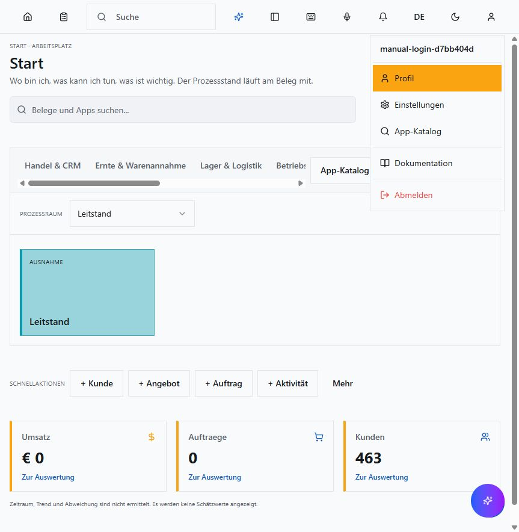
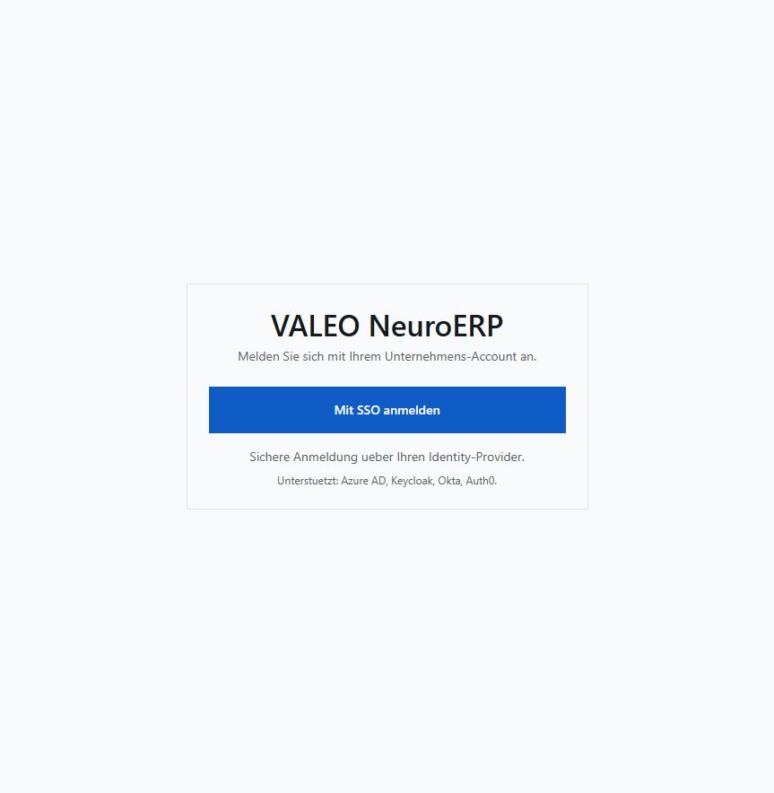
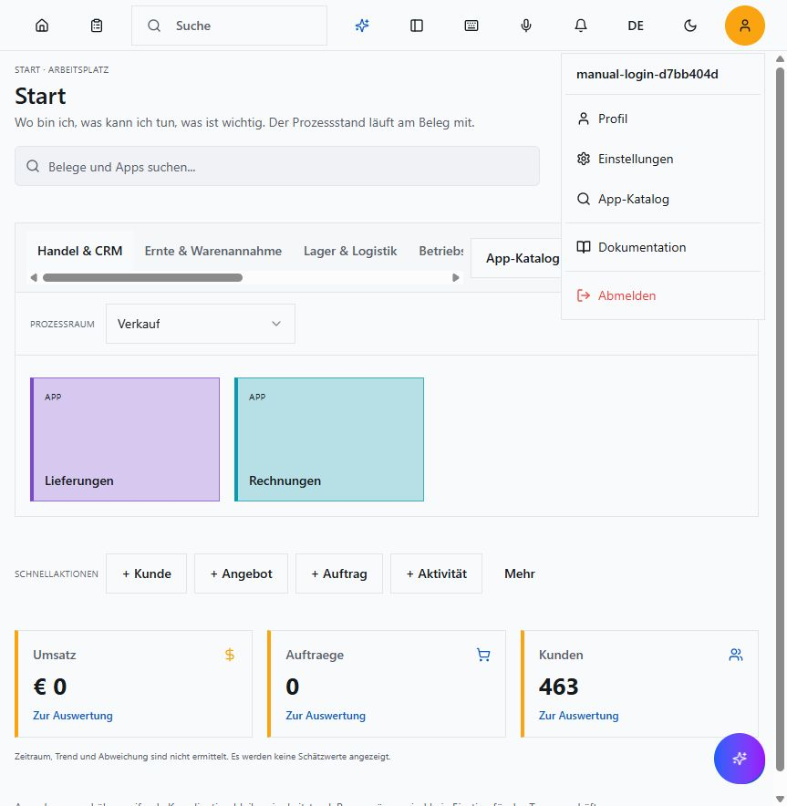

# Anmeldung und Abmeldung

Stand 13.10.2026, lokale Entwicklungsanwendung auf Port 3001 und bestehender
Keycloak auf Port 8080. Die Aufnahmen zeigen eine eigene synthetische Testkennung;
persoenliche Administratorzugangsdaten werden nicht dokumentiert.

1. Auf der Loginseite **Mit SSO anmelden** waehlen.
2. Beim Anmeldedienst die vorhandene Benutzerkennung und das Kennwort eingeben.
3. Nach erfolgreicher Anmeldung erscheint **Start**. Im **Benutzermenue** steht
   die angemeldete Kennung. Der Menuepunkt **Abmelden** beendet die Sitzung.

4. Nach **Abmelden** erscheint wieder die Loginseite. Ein erneuter Klick auf
   **Mit SSO anmelden** hat im getesteten lokalen Provider erneut die
   Kennwortmaske geoeffnet.

Leere Anmeldung, unbekannte Kennung und falsches Kennwort wurden ebenfalls real
zurueckgewiesen. Die Passwortwiederherstellungsmaske wurde geoeffnet; es wurde
keine Nachricht versendet. Kennwortwechsel und Authenticator-Einrichtung sind
noch nicht als ausgefuehrte Browserabnahme dokumentiert. Die persoenliche
Erstanmeldung bleibt wie vereinbart vertagt.

Technische Nachweise und offene Varianten stehen in der
[Login-Testmatrix](../quality-assurance/login-variants-20261013.md).

## Sitzung nach Ablauf des ersten Zugriffstokens

Der lokale Anmeldedienst war auf 300 Sekunden Zugriffstokenlaufzeit eingestellt.
Nach mehr als 333 Sekunden wurde die Seite erneut geladen. Der geschuetzte
Arbeitsplatz und dieselbe synthetische Kennung blieben sichtbar, ohne erneute
Kennworteingabe. Die Providererneuerung erhaelt den Zugang; fehlgeschlagene oder
widerrufene Erneuerungen erlauben keinen Zugriff.

