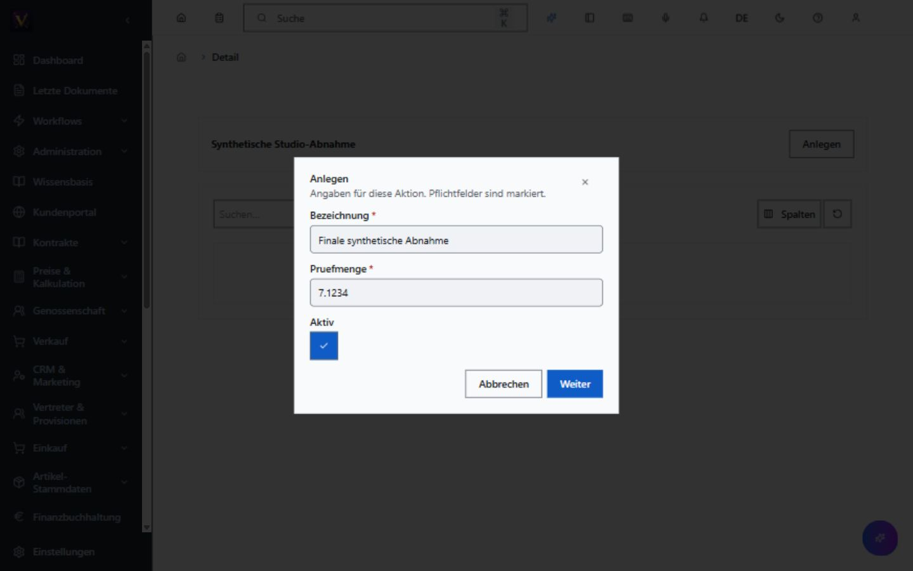
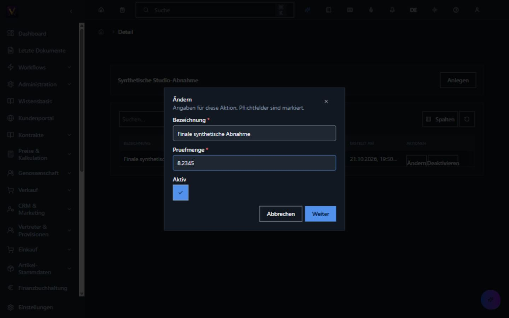
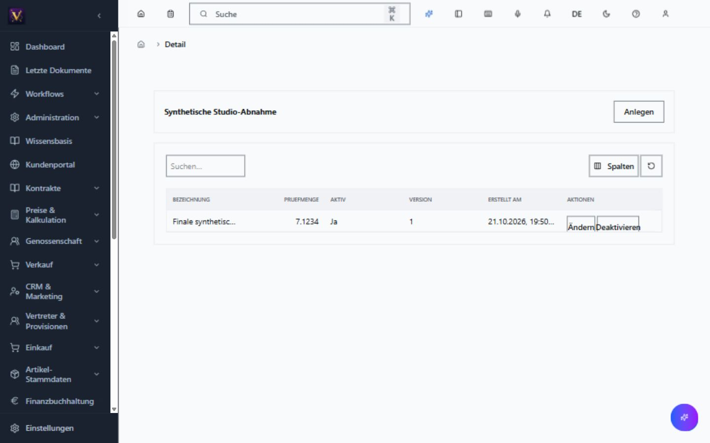
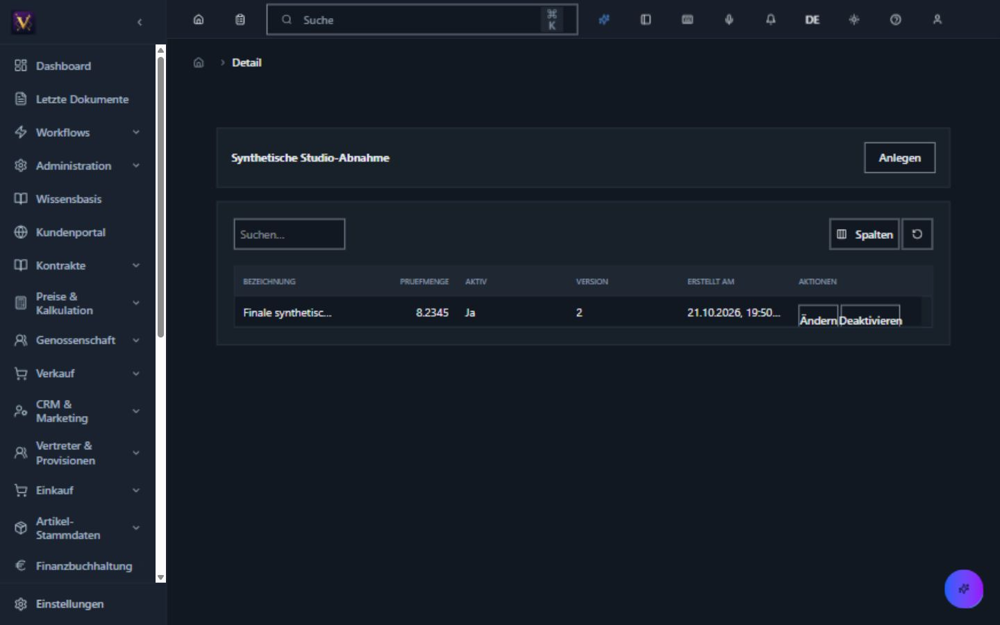
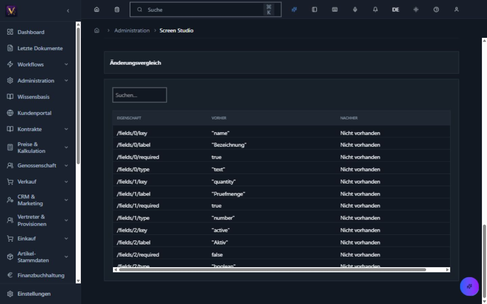

# Studio-generierte Stammdaten bedienen

Die folgende Maske ist ein synthetisches Beispiel aus dem gemeinsamen Testpruefstand. Die Testfreigabe wurde nach der Abnahme zurueckgezogen. Sie ist keine aktive Fachmaske und keine Freigabe aller bisherigen Masken.

## Anlegen und bearbeiten

Nach Anmeldung wird die freigegebene Maske ueber ihre registrierte Navigation geoeffnet. Mit **Anlegen** erscheint der aus der Maskendefinition erzeugte Eingabedialog. Pflichtfelder sind markiert; Zahlen und Ja/Nein-Werte besitzen passende Eingabeelemente. **Weiter** fuehrt zur erforderlichen Begruendung und Bestaetigung. Erst der bestaetigte Fachcommand speichert. Nach Erfolg aktualisiert sich die Liste.

Die Maske und der Dialog uebernehmen das gewaehlte Theme.

Beim Bearbeiten sendet die Anwendung die angezeigte Datensatzversion. Wurde der Datensatz inzwischen anderweitig geaendert, wird die veraltete Aenderung abgewiesen. Ein erneuter Versuch nach unsicherem Ausgang verwendet denselben Auftragsschluessel; bewusst geaenderte Eingaben erhalten einen neuen.

**Deaktivieren** entfernt den Datensatz aus der aktiven Liste, erhaelt aber dessen Ausfuehrungsnachweise. Die Berechtigungen und Mandantenzugehoerigkeit werden bei jeder Aktion serverseitig geprueft.

## Fassungen nachvollziehen

Im Studio einen gespeicherten Entwurf oeffnen. Unter **Studio-Historie** stehen Zeitpunkt, handelnde Kennung, Aktion, Status, Version und Simulationsergebnis. **Aenderungen ansehen** zeigt fuer die gewaehlte Fassung die Eigenschaften vorher und nachher. Statuswechsel ohne Definitionsaenderung koennen einen leeren Vergleich besitzen.

Diese Historie beschreibt Maskenfassungen. Sie ersetzt weder das Belegaudit noch die Buchungshistorie.

## Abmelden

Im Benutzermenue **Abmelden** auswaehlen. Auch eine abgelaufene Sitzung mit noch zwischengespeicherter Anzeige darf lokal beendet werden. Danach erscheint die Anmeldeseite.

## Bedienung ueber CLI und Agent

Fuer dieselben generierten Commands gelten identische Fachregeln. Bei CLI-Aenderungen und Deaktivierung ist die zuvor gelesene Version erforderlich. Ein automatisch erzeugter Idempotenzschluessel wird ausgegeben und muss bei einem unsicheren Ergebnis fuer die Wiederholung erhalten bleiben. Schreibende Agentenfaehigkeiten sind standardmaessig deaktiviert und benoetigen eine ausdrueckliche Freischaltung fuer Capability und bestehende Bereichsrolle. Sichtbarkeit eines Werkzeugs gewaehrt keine Schreibrechte.
