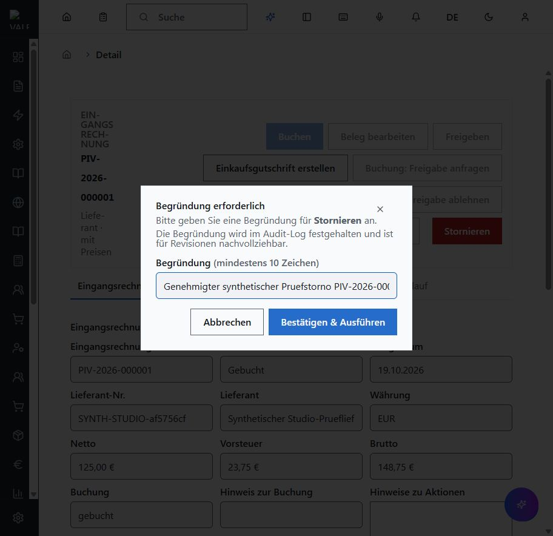
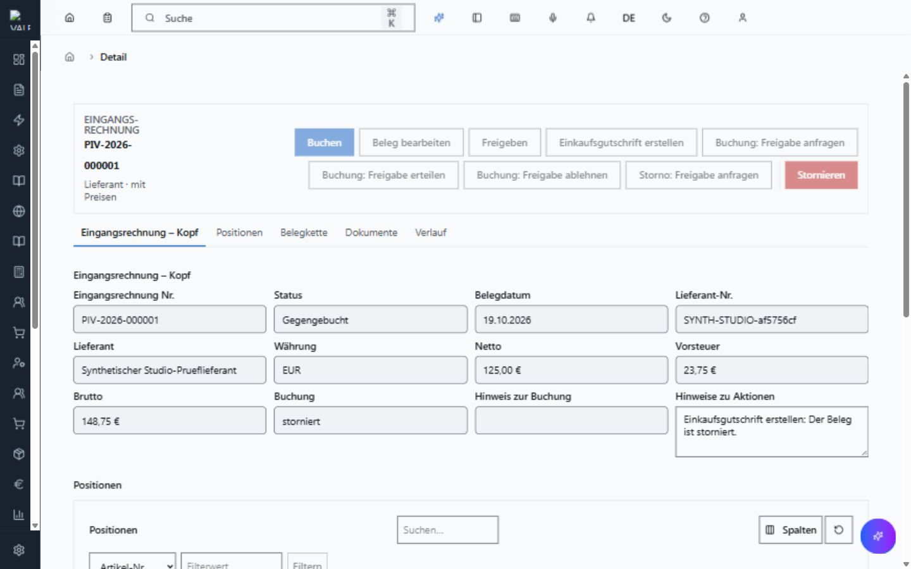
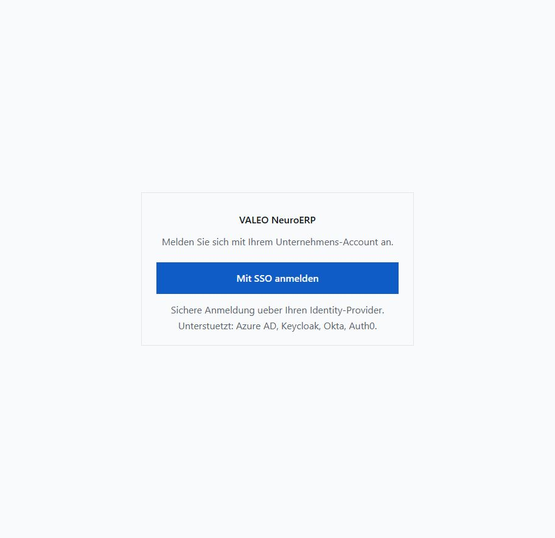

# Echter Browser-Storno der synthetischen Eingangsrechnung

## Freigabe und Ablauf

Der Auftraggeber hat den Storno der synthetischen Rechnung PIV-2026-000001 sowie die voruebergehende Rolle FINANCE_BEARBEITEN fuer die bestehende Testkennung ausdruecklich freigegeben. Nur der bereits freigegebene Testmandant im vorhandenen valeo_probe wurde benutzt. Keine neue Datenbank, Container, Migration, Reset oder externe Zahlung. Die vorherigen Rollen wurden vor der Vergabe festgehalten, der Mandantenbezug geprueft und bestehende Sitzungen beendet. Nach echter erneuter SSO-Anmeldung war Stornieren verfuegbar.

Bedienfolge: gebuchte Rechnung oeffnen, Stornieren waehlen, kritische Aktion bestaetigen, Pflichtbegruendung eingeben, Bestaetigen & Ausfuehren. Verwendete Begruendung: Genehmigter synthetischer Pruefstorno PIV-2026-000001. Die bestehende fachliche Freigabepruefung bleibt wirksam; es wurde keine Sonderregel in Produktionscode eingebaut.

## Gefundener und behobener Fehler

Die echte Pruefung fand einen zentralen UI-Fehler: Radix AlertDialogAction schloss nach onClick automatisch den Bestaetigungsdialog. Dadurch rief onOpenChange den allgemeinen Reset auf und entfernte die gerade geoeffnete Auditbegruendung. Es wurde noch kein Fachcommand gesendet. Die native Detailseite verhindert nun nur das automatische Schliessen beim Bestaetigen; der kontrollierte Ablauf schaltet selbst auf Vorschau, Begruendung oder Ausfuehrung um. Abbrechen und der Schutz vor Ausfuehrung ohne Begruendung bleiben erhalten. Keine doppelte Masken-Engine, keine Aenderung der Fach-, Rechte- oder Freigaberegeln.

Vor Reparatur: zwei neue Dialogtests rot, Abbruch an erster Stufe gruen. Nach Reparatur: 19 Tests in vier Dateien gruen, darunter echte Radix-Bestaetigung -> Begruendung, Mindestlaenge, Abbruch an beiden Stufen, bestehende Vorschaufehler, gebundene Buchungsbestaetigung und Entwurfsbearbeitung. Vollstaendige abschliessende Typpruefung ebenfalls bestanden.

## Tatsachliche Buchungswirkung und Wiederholung

Der Browser zeigt Gegengebucht und Buchung storniert. Echte SQL-Abnahme gegen denselben Beleg:

| Nachweis | Ergebnis |
|---|---|
| Originaljournal | Status reversed; urspruengliche Zeilen, Summen, Sequenz 1 und Inhaltshash erhalten |
| Gegenjournal | Genau einmal posted, Sequenz 2, Vorgaengerhash gleich Originalhash; beidseitiger Original-/Stornobezug |
| Soll Gegenbuchung | Konto 1600: 148,75 EUR |
| Haben Gegenbuchung | Konto 3400: 125,00 EUR; Konto 1576: 23,75 EUR |
| Ausgleich | Soll = Haben = 148,75 EUR; je Konto Original plus Gegenbuchung saldiert null |
| Offener Posten | offen = open_amount = 0,00 EUR; Status storniert |
| Protokoll | Genau ein Stornocommand mit geprueftem Akteur und eingegebener Begruendung |
| Gleicher Schluessel/Inhalt | Bestehender Stornoerfolg wiedergegeben; kein zweiter Nachweis |
| Gleicher Schluessel/anderer Grund | Konflikt, keine Wirkung |
| Neuer Schluessel auf storniertem Beleg | Konflikt, keine Wirkung |

Die Gegenbuchung wurde ausschliesslich ueber den regulären Browser-/REST-Domainweg erzeugt. Die anschliessende SQL-Abnahme liest die realen Nachweise und ruft nur Replay beziehungsweise gesperrte Wiederholungen desselben Commands auf; sie erzeugt keine fingierten Gegenbuchungen. Der Originalbeleg und sein Journal werden nicht physisch geloescht.

## Rechteentzug und Grenzen

Unmittelbar nach Abschluss: temporaere FINANCE_BEARBEITEN-Zuweisung entfernt, exakte urspruengliche direkte Rollen wiederhergestellt, alle Keycloak-Sitzungen beendet. Keine Passwoerter, Token, persoenlichen Kennungen oder Kontaktdaten im Repository. Die Einkaufs-Testkennung wird nicht dauerhaft gesperrt; ihre zuvor genehmigten Einkaufsrechte bleiben erhalten.

Der Browser wurde nach Rechteentzug neu geladen und auf die Anmeldeseite zurueckgeleitet.

Diese Abnahme belegt eine regulaere, unbeglichene Eingangsrechnung ohne weitere Korrekturen. Sie ersetzt nicht die gesonderte Pruefung teilweise bezahlter oder durch Gutschriften veraenderter Posten und ist kein Nachweis fuer den weiterhin offenen Storno gebuchter Gutschriften. Globaler Rollout, schreibende MCP-Freigabe und weitere CI-Restbefunde bleiben getrennt.
