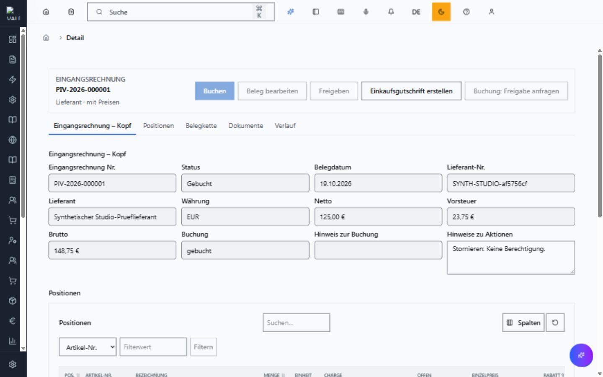
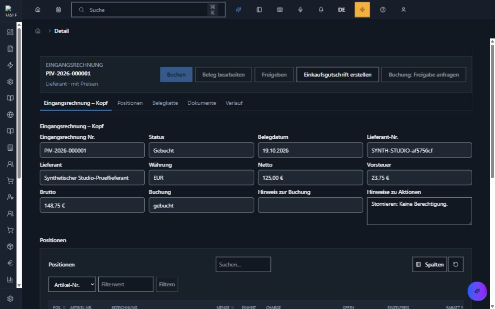

# Gemeinsame Belegneuanlage und echte Buchungsabnahme

## Bedienung

Die gemeinsame Belegmaske bietet neun registrierte Varianten. Im bereits freigegebenen Sichtpruefungsmandanten wird ein neuer Beleg unter /belege/{belegart}/new geoeffnet. Entwurfsbezeichnung und Belegdatum eingeben, den Kunden oder Lieferanten nach Nummer beziehungsweise Name suchen und einen Treffer auswaehlen. Anschliessend Positionen mit Artikel, Menge, Einheit und bei Preisbelegen Preis und Steuerschluessel erfassen. Im Einkauf kann das Aufwandskonto angegeben werden. Speichern oeffnet den erzeugten Entwurf. Freigeben vergibt die endgueltige Belegnummer; Buchen fuehrt nach Bestaetigung den bestehenden Fachcommand aus. Die serverseitigen Rollen- und Freigaberegeln gelten unveraendert.

## Umsetzung und Schutz

Familienfassung 1.2.0 ergaenzt dieselbe deklarierte creation-Struktur fuer alle neun Varianten. Alte Basis-/Variantenfassungen bleiben unveraendert. Zentraler Renderer, Formularzustand und Lookup bleiben fuehrend; keine zweite Belegseite. Die Partnerauswahl filtert nach dem verifizierten Mandanten und dem vorhandenen Bearbeitungsrecht. Der Command prueft die Referenz vor Mutation erneut und sperrt sie in der Transaktion gegen konkurrierendes Entfernen. Sichtbares Uebertippen einer Auswahl verwirft die alte Kennung.

Der Server liefert den aktiven Definitionshash. Create verwendet nur erlaubte Eingaben, unveraenderlichen Erstellungskontext und einen beim Wiederholen desselben Auftrags stabilen Schluessel. Belegart und Entwurfsstatus kommen aus der geladenen Variante; mitgelieferte Mandanten-/Urheber-/Statuswerte werden nicht uebernommen. Der bestehende Domain-Command garantiert Transaktion und Wiederholungsschutz. Studio darf nur den exakten registrierten Erstellungstransport importieren; generische oder verschachtelte Schreibendpunkte bleiben verboten.

Die echte Browserpruefung fand einen Navigationsfehler: Der erfolgreiche API-Aufruf versuchte die Detailnavigation vor Entfernung der Ungespeichert-Sperre. Die zentrale Neuanlage navigiert jetzt erst nach erfolgreichem Formularabschluss ohne schmutzige Felder. Ein Regressionstest prueft diesen Zustand zum Navigationszeitpunkt.

## Nachweise

- 139 Backendfaelle fuer Varianten, Historie, Partnerisolierung, echten SQL-Create/Replay, Rollen, Provenienz und Studio-Sicherheitsgrenzen bestanden.
- 20 gezielte UI-Faelle bestanden; anschliessend sechs zentrale Neuanlagefaelle einschliesslich Navigationsregression erneut bestanden. Vollstaendige Typpruefung nach der Navigationskorrektur und Produktionsbuild bestanden (bestehende Bundle-Groessenwarnung bleibt sichtbar).
- Echte SSO-Anmeldung mit bestehender synthetischer Einkaufskennung, sichtbare Lieferantenauswahl, Positionsanlage, Speichern, Freigeben und Buchen im bestehenden valeo_probe. Keine neue Datenbank, Container, Migration oder Rechtevergabe.
- Bestellung SYNTH-STUDIO-af5756cf als Entwurf gespeichert. Eingangsrechnung PIV-2026-000001 tatsaechlich gebucht: 125,00 EUR netto, 23,75 EUR Vorsteuer, 148,75 EUR brutto. Journalstatus posted, Sequenz 1 und 64-stelliger Verkettungshash vorhanden. Soll: Konto 3400 mit 125,00 EUR und 1576 mit 23,75 EUR. Haben: Konto 1600 mit 148,75 EUR. Summe Soll = Haben = 148,75 EUR. Genau ein offener Posten ueber 148,75 EUR.
- Derselbe Buchungsschluessel liefert den bestehenden Erfolg; neuer Schluessel fuer den bereits gebuchten Beleg wird abgewiesen. Danach weiterhin genau ein Buchungsnachweis. Kein Zahlungslauf, Versand oder externe Meldung ausgefuehrt; Hintergrundpublisher im isolierten lokalen Pruefserver aus.
- Ein erster Createversuch scheiterte korrekt vor Mutation, weil dem frischen Pruefmandanten der Steuerschluessel fehlte. Nur im freigegebenen synthetischen Mandanten fehlende SKR03-Konten und Schluessel eingerichtet, danach unveraenderte Eingabe erfolgreich gespeichert.
- Helle und dunkle Darstellung bei 1440 x 900 im echten Browser dokumentiert. Das ist keine Abnahme aller Varianten, Bildschirmgroessen oder eine vollstaendige Barrierefreiheitszertifizierung.

API-Projektion: genau ein neuer GET-Pfad fuer Partnerauswahl, alle bisherigen OpenAPI-Pfade und Komponenten exakt unveraendert. Historische Registereintraege exakt verglichen und unveraendert; nur aktuelle Zeiger auf 1.2.0 weitergesetzt. Variantenregister, fuenf Agent-Handbuchartefakte, drei Codeinventare, vollstaendiger Architekturindex, C4-/Containerprojektionen und strikter Architekturdrift gruen. Markdown-/Docs-Governance gruen.

## Verbleibende Grenzen

Keine globale Aktivierung und keine automatische Studio-/MCP-Schreibfreigabe. Die bisherigen 14 Einstiege bleiben bis zur jeweiligen Sonderfeld-/Fachkettenparitaet bestehen. Reine Finanzrechnung und Belastung sind keine stillschweigend gleichgesetzten Varianten. Vollersatz verknuepfter Positionen und reine Lager-Mengenbearbeitung bleiben getrennte Aufgaben. Der Browsernachweis betrifft Einkauf, nicht alle neun Rollenvarianten. Stornieren ist fuer diese Einkaufs-Testkennung nicht erlaubt und wurde weder durch Rechteerweiterung noch Umgehung erzwungen. Der gebuchte Testbeleg bleibt als nachvollziehbarer Nachweis bestehen; keine direkte Loeschung gebuchter Daten. Voll-UAT, authentifizierter Runtime-Sweep und Gutschrift-Stornosemantik bleiben offen.
